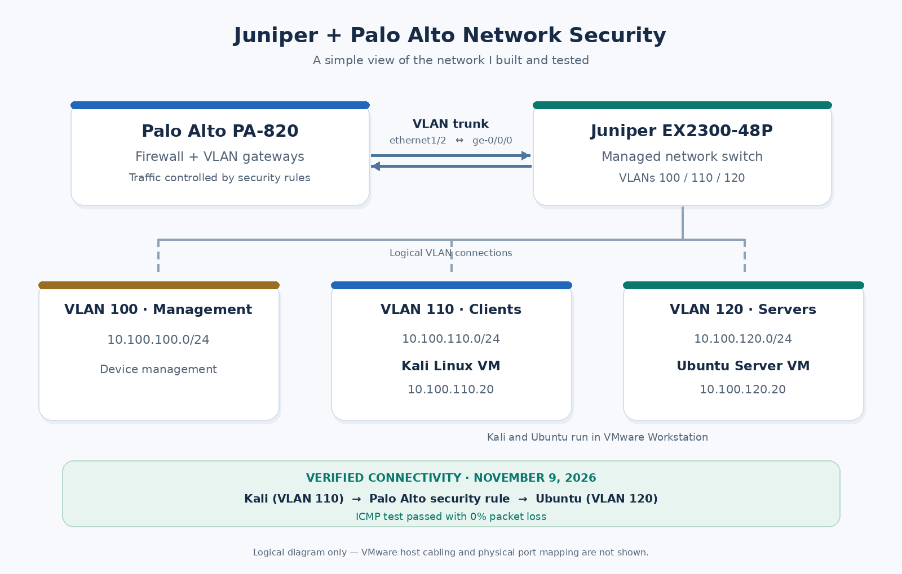

# Network Topology

This is the basic layout of my Juniper and Palo Alto network project. I used a physical switch and firewall with VMware virtual machines to test how traffic moves between separate VLANs.

## How everything connects

- **Juniper EX2300-48P:** The switch handles VLANs 100 (management), 110 (clients), and 120 (servers).
- **Palo Alto PA-820:** The firewall is connected to the Juniper switch over a VLAN trunk (`ge-0/0/0` on Juniper to `ethernet1/2` on Palo Alto). It provides the VLAN gateways and controls traffic between networks.
- **VMware Workstation:** I used Kali Linux (`10.100.110.20`, VLAN 110) and Ubuntu Server (`10.100.120.20`, VLAN 120) as test machines.

## Connection test

On **November 9, 2026**, I successfully pinged Ubuntu from Kali across the VLANs, with **0% packet loss**. The Palo Alto policy used for that test was named `ALLOW-KALI-TO-UBUNTU-ICMP`.

This diagram shows the **logical network**, not a complete cable-by-cable port map. I’ll add more device configurations and screenshots as I document the remaining setup.
